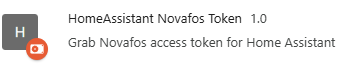

# Chrome and Firefox extension: ha-novafos-token



**Security notice: Please do yourself a favor and make a habit of checking that extensions don't transmit your personal info to the Internet.  This extension reads headers of your browser traffic and extracts the authentication token allowing a web application, like the official webpage application to retrieve your data from the KMD data storage.  The Bearer token extracted is only valid for 60 minutes but this is enough for anyone to grab your personal data.**

The extension will only transmit the token to the server you specify, and only over HTTPS. The source code is open for inspection/verification, do youself a favor and take a look to see how it does it.

With that out of the way...

## 🚀 What does this do?

Retrieve a Bearer token from Novafos website and inject into Home Assistant using a service action call.

When logging into Novafos using either email/password or MitID, this extension will inspect headers from network traffic and present the user with a button to send it to Home Assistant.

## 🔑 Key Features
- Enables much easier update of Novafos water/heating use data in Home Assistant.
- Captures Bearer tokens only from `https://easy-energy-plugin-api.kmd.dk/api/*`, matching header names and the Bearer scheme case-insensitively.
- Rejects expired tokens and tokens without a readable numeric JWT `exp` claim, both when capturing and when retrieving them for sending. Expiry checks do not verify the JWT signature; sending a token does not extend its validity.
- Reports successful delivery only after Home Assistant returns a successful HTTP response. HTTP errors and network failures are shown in the popup.

Broad host permissions are retained so the extension can send tokens to your configured Home Assistant address, not to capture tokens from other websites. Captured tokens and Home Assistant credentials are not logged to the console.

## 🌐 Browser support
Separate Manifest V3 builds are generated for Chrome (background service worker) and Firefox (background scripts). Chromium-based browsers can use the Chrome build.

### Development Setup

Use the Node.js version specified in `.nvmrc` and the npm version specified by `packageManager` in `package.json`.

With [nvm](https://github.com/nvm-sh/nvm), run these commands from the repository root:

```sh
nvm install
nvm use
npm install --global npm@12.2.1
npm ci
```

If you use another Node version manager, select the same versions and run `npm ci`. Use the npm scripts below to run the locally installed build and signing tools; no global `web-ext` installation is required.

### Build Both Browsers

Build from the repository root:

```sh
npm run build
```

Use these generated outputs:

- `dist/chrome/`: load this directory as an unpacked Chrome extension.
- `dist/firefox/`: load its manifest as a temporary Firefox add-on.
- `dist/ha-novafos-token-chrome-<version>.zip`: Chrome package.
- `dist/ha-novafos-token-firefox-<version>.unsigned.xpi`: Firefox package for submission to Mozilla, not permanent installation.

To build only one browser, run `npm run build:chrome` or `npm run build:firefox`. Load the generated browser directory rather than the source directory so the browser receives the correct manifest. Rebuild after changing extension files.

For permanent Firefox installation, sign the package using one of the methods below.

### Test and Validate

Before distributing a build, run:

```sh
npm test
npm run lint:firefox
```

Resolve lint errors and review warnings before submitting to Mozilla. Test the generated extensions in both browsers.

### Update Dependencies

Check for newer releases and known vulnerabilities:

```sh
npm outdated
npm audit
```

Review the findings and proposed version changes before applying fixes; do not use `npm audit fix --force` blindly. Update dependency pins in `package.json` and regenerate `package-lock.json` with `npm install`. When changing Node.js or npm versions, also update `.nvmrc`, `engines`, and `packageManager` as applicable. Then run `npm ci`, `npm test`, `npm run build`, and `npm run lint:firefox`.

### Build a Signed Firefox XPI

Mozilla signs Firefox extensions through [Mozilla Add-ons (AMO)](https://addons.mozilla.org/developers/). You cannot produce a release-compatible signature locally. Use **unlisted/self-distributed** signing to install or share the extension without publishing a public AMO listing. Unlisted extensions still undergo validation and are subject to Mozilla's add-on policies and review.

Before submitting an update, increase `version` in `ha-novafos-token/manifest.json` and rebuild. Keep `browser_specific_settings.gecko.id` unchanged for updates to the same extension; the submitting AMO account must own that ID. For a separately maintained fork, choose a unique ID before the first submission.

**Web upload (no signing CLI or API credentials needed):**

1. Run `npm ci` and `npm run build:firefox` from the repository root.
2. Sign in to the [AMO Developer Hub](https://addons.mozilla.org/developers/) and choose to submit a new add-on, or upload a new version of your existing add-on.
3. For a new add-on, choose self-distribution ("On your own"), not public listing on AMO.
4. Upload the versioned `dist/ha-novafos-token-firefox-<version>.unsigned.xpi` generated by the build. Complete Mozilla's validation, data-collection declarations, and any requested source-code or review information. Fix validation errors in the source and rebuild before resubmitting.
5. After approval, download the **signed** XPI from the Developer Hub. Renaming the unsigned archive does not sign it.

**CLI signing (using the pinned project toolchain):**

Create a JWT issuer and JWT secret on the [AMO API credentials page](https://addons.mozilla.org/developers/addon/api/key/). These are your Mozilla developer credentials, not the Novafos or Home Assistant tokens. Enter them directly in your own Bash terminal using the prompts below; do not put credentials into tracked files, command arguments, or chat.

```sh
npm ci
npm run lint:firefox

read -rp "AMO JWT issuer: " WEB_EXT_API_KEY
read -rsp "AMO JWT secret: " WEB_EXT_API_SECRET
printf '\n'
export WEB_EXT_API_KEY WEB_EXT_API_SECRET

npm run sign:firefox

unset WEB_EXT_API_KEY WEB_EXT_API_SECRET
```

Run the credential prompts and signing command only after resolving lint errors and reviewing warnings. Complete Mozilla's data-collection declarations and any requested source-code or review information before release.

The signing command rebuilds, lints, and uploads the Firefox package. After approval, use the signed XPI in `dist/firefox-signed/`, not the unsigned archive in `dist/`. If the command times out waiting for approval, check the Developer Hub and download the signed file there once approved.

To install the signed result permanently, open `about:addons` in Firefox, use the gear menu, select **Install Add-on From File**, and choose the downloaded signed XPI. Repeat the version bump, build, and signing steps for future releases. Self-distributed installations need manual updates unless you configure Firefox's self-hosted update mechanism.

See Mozilla's [signing and distribution overview](https://extensionworkshop.com/documentation/publish/signing-and-distribution-overview/) and [`web-ext sign` reference](https://extensionworkshop.com/documentation/develop/web-ext-command-reference/#web-ext-sign) for current requirements.

## 🎯 How to Use

### Daily use
1. Go to novafos.dk, and login as you would normally using user/pass or MitID. I strongly recommend using a password manager like Bitwarden/Vaultwarden.
2. The extension will show a little "OK" badge when a token is detected.
3. Click the extension icon to open the popup
4. Click the "Send token to home assistant" button.
5. Data in Home Assistant should now update directly.

## 🎯 How to Install

### Requirements

- Chrome, Firefox, or a compatible browser.
- Access to Home Assistant via HTTPS.  If you don't know how to serve HA through HTTPS, see below for a Traefik setup or look for help on the forums.

### Home Assistant first time setup
1. Make sure your Home Assistant is using HTTPS.  This is important because
   calling a HTTP (unsecure) site from a secure page is not allowed, nor advisable.
   You can configure caddy, nginx, Traefik, Tailscale, maybe even Home Assistant itself to use SSL/HTTPS.
2. If you setup a HTTPS proxy like Traefik, you want to put this into the http-section in `configuration.yaml`:
```
    http:
        use_x_forwarded_for: true
        trusted_proxies:
            - <your-proxy-IP>
```
3. Restart Home Assistant

#### If you face trouble with CORS

If you for some reason get CORS erors, you may need to add permission for the extension to do what it does. Try this:

1. Open your `configuration.yaml` file.
2. Add a section like this to allow the extension to call the HA REST API.
```
    http:
        cors_allowed_origins:
            - chrome-extension://ghmhahihkmbifnlhcjfldfjlmmcjppko
            - https://minforsyning-2.kmd.dk
```

### Chrome installation first time use

1. Download the repository and run the build commands above.
2. In chrome go to [Chrome extensions](chrome://extensions/)
3. Enable "developer mode"
4. Click "load unpacked"/"indlæs upakket" and browse to the generated directory `dist/chrome`. Press the okay button.
5. The extension should be added to Chrome now.
6. Click the little 'puzzle piece' and pin the extension.

Will I publish the extension on the Chrome store? No. The scope for this is so limited it is for the enthusiast user.

### Firefox Development Installation

1. Run the build commands above.
2. Open `about:debugging#/runtime/this-firefox` in Firefox.
3. Click "Load Temporary Add-on" and select `dist/firefox/manifest.json`.
4. The temporary add-on remains loaded until Firefox restarts. For permanent installation, install a Mozilla-signed XPI through `about:addons`.

### First time configuration

1. Click the extension and a small popup window will appear.
2. Enter your Home Assistant HTTPS URL (no trailing /, please): ```https://homeassist.my.home```
3. Enter your Home Assistant long lived access token: ```eyJhbGciOiJIU....```
4. Click the "Check this box ...".

If you have a test instance (or just another instance) of Home Assistant, you can click the development mode button and fill out a
second set of fields.  As long as this box is checked service calls will go to this other instance.

---

# Using Traefik-proxy to get Home Assistant on HTTPS

If you are unsure how to serve Home Assistant via HTTPS (which is a requirement for the Chrome extension), you can find an example here using Traefik as a docker-compose file and static setup.
There are several other ways to do this of course.

In the `traefik-proxy` directory you will find a docker-compose file and static setup for proxying Home Assistant.  Try it out.  Then read about Traefik and never ever expose your Home Assistant directly to the Internet.  Use Tailscale or NabuCasa for this.

Alternatives are Apache, Nginx, Caddy, Traefik, NabuCasa.
There is a thread here which may help too: [https://community.home-assistant.io/t/connecting-to-ha-locally-using-https/566441/50](https://community.home-assistant.io/t/connecting-to-ha-locally-using-https/566441/50)

Note: Only the Traefik setup is tested as part of the development of this extension.
